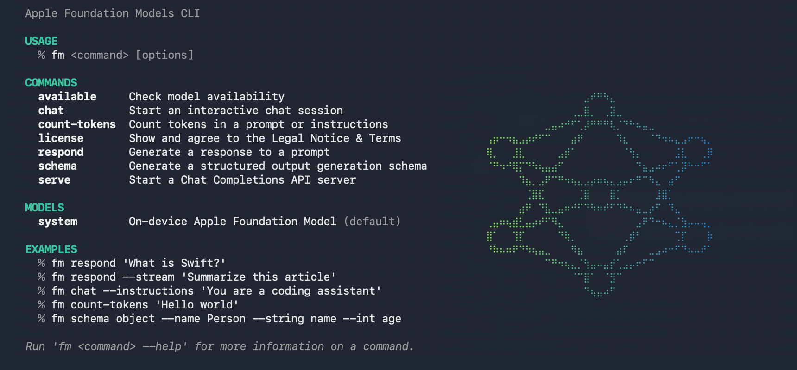

# On-Device Apple Foundation Model



**An unofficial, tested guide to `fm`, the command that runs Apple's on-device language model from Terminal on macOS 27.** Free, private and offline: no account, no API key, no token bill. Setup takes about two minutes.

This is not an Apple project. Everything below was run on an Apple Silicon iMac on macOS 27.0.1 (build 26A434) on October 24 and 29, 2026. Where something was not tested, it says so.

- [What it is](#what-it-is)
- [Set it up](#set-it-up)
- [Everyday use](#everyday-use)
- [Get JSON back](#get-json-back)
- [Chat](#chat)
- [Shell helpers](#shell-helpers)
- [Local API server](#local-api-server)
- [Limits](#limits)
- [Troubleshooting](#troubleshooting)
- [Under the hood](#under-the-hood)
- [Model card](MODEL_CARD.md)

## What it is

`fm` is a front end for Apple Foundation Models, the on-device model behind Apple Intelligence: AFM 3 Core (3B parameters) or, on more capable Macs, AFM 3 Core Advanced (20B sparse, 1–4B active). Specs are in the [model card](MODEL_CARD.md). It ships with macOS 27 at `/usr/bin/fm`; there is nothing to install.

You need:

- An Apple Silicon Mac on **macOS 27** or later. On macOS 26 the command does not exist.
- **Apple Intelligence** turned on, with its model downloaded. Apple's framework has a specific "Apple Intelligence not enabled" state, so this is required. The download needs internet once; after that `fm` works offline.
- An administrator password, once, to accept Apple's terms.

**Not every Mac gets the same model.** Apple ships two on-device models and says the larger one, AFM 3 Core Advanced, is only for its "most capable Apple silicon systems". Apple has not said which Macs those are. The M4 iMac used for this guide got Core Advanced; an older or smaller Mac may get the 3B AFM 3 Core, which could make answers and speed differ from the results here. To see what your Mac reports, run [`tools/model-info.swift`](tools/model-info.swift) (instructions in the [model card](MODEL_CARD.md#check-your-own-mac)), and please [share the result](../../issues) with your chip and memory. Treat the name it prints as a hint: Apple's framework picks it from the context size alone (8,192 tokens gives "Core Advanced"). The [model card](MODEL_CARD.md#which-model-you-get) has the details.

It is good at short text jobs: summarizing, extracting fields, classifying, tagging, rewriting, describing an image. It is not a replacement for a large chat model. Expect weak answers on code, maths and anything needing world knowledge.

## Set it up

1. **Check your version.** Apple menu → About This Mac should say macOS 27. In Terminal, `which fm` should print `/usr/bin/fm`.
2. **Turn on Apple Intelligence.** In System Settings, open the Apple Intelligence section and switch it on. Wait for the model download to finish.
3. **Accept the terms, once.** Open **Terminal.app** and run:

   ```sh
   sudo fm license
   ```

   Type your Mac password (nothing shows as you type), read the notice, then answer `y`. Agreeing covers every user on the Mac, which is why it needs `sudo`. Use Terminal.app itself, not an AI coding assistant's shell: a password typed there can end up in its chat log.

4. **Confirm it took.** `fm license --status` should say `Agreed to license FM1 version 1.0 on …`.
5. **Check the model.** `fm available` should print `System model available`.
6. **Ask something.**

   ```sh
   fm respond "What can you do?"
   ```

   The answer streams in. A short one takes under two seconds.

**What you agree to in step 3:** Apple's macOS software licence, plus a promise not to "programmatically access or use Apple models … except as expressly permitted". Print the full text without agreeing with `fm license --show`.

## Everyday use

**Always start with `fm respond` or `fm chat`, and put your text in quotes.** A question typed straight into Terminal goes to the shell, not the model, and zsh treats `?` as a filename wildcard.

The examples use [`examples/notes.txt`](examples/notes.txt). Clone this repo and `cd examples` to run them as written.

| Task | Command | Tested result |
| --- | --- | --- |
| One question | `fm respond "What can you do?"` | Streams the answer; `--no-stream` prints it all at once |
| Summarize a file | `cat notes.txt \| fm respond -i "Summarize in one line"` | `Meeting moved to Thursdays; Alex owns reading list; snack budget $40; next review November 3.` |
| File plus your own question | `fm respond -i "Answer from the text only" --text "$(cat notes.txt)" "Who owns the reading list?"` | `Alex owns the reading list.` |
| Describe an image | `fm respond --image photo.png "What is in this picture?"` | Described a PNG screenshot correctly |
| Read the text in an image | `fm respond --tool ocr --image photo.png "Read the text in the image."` | The model called Apple's OCR tool and quoted the screenshot's text. `--tool barcode` is the barcode equivalent (not tested) |
| Tag a piece of text | `fm respond --use-case content-tagging "Our book club meeting moves to Thursdays starting in November."` | `book club, meeting, schedule, Thursdays, November` |
| Rewrite text the safety filter blocks | `fm respond --guardrails permissive-content-transformations "Rewrite this scene more vividly: …"` | A fictional sword-fight rewrite that failed with the default filter went through |
| Repeatable answers | add `-g` (greedy sampling) | Same output every run |
| See what it is doing | add `-v` | Prints only whether instructions were used; little else |
| Count tokens | `fm count-tokens "$(cat notes.txt)"` | Prints a number; check before sending long text. `--image` fails with `ModelManagerError error 1001` |
| Continue a one-shot | `fm respond --save-transcript t.json "My dog's name is Biscuit. Just say OK."` then `fm respond --resume t.json "What is my dog's name?"` | `Biscuit.` |

**The pipe trap:** if you pipe text in *and* type a prompt, `fm` uses only the prompt and silently ignores the piped text. Pipe alone, or pass the file with `--text`.

**Instructions cost about 55 tokens.** `fm count-tokens "Hello world"` gives 3, but adding even `-i "x"` gives 59, because the count then includes Apple's chat template around your text. Allow for this when you work near the limit.

## Get JSON back

Describe the fields with `fm schema object`, then pass the result to `--schema`, either inline or as a file:

```sh
echo "Lunch with Sam on Friday at noon at Luigi's" | fm respond -i "Extract the event" \
  --schema "$(fm schema object --name Event --string who --string day --string time --string place)"
```

```json
{"place": "Luigi's", "time": "noon", "day": "Friday", "who": "Sam"}
```

Saved to a file instead ([`examples/task.schema.json`](examples/task.schema.json)):

```sh
fm schema object --name Task --string owner --description "who owns it" --string day --integer budget > task.schema.json
cat notes.txt | fm respond -i "Extract the task" --schema task.schema.json
```

```json
{"owner": "Alex", "budget": 40, "day": "Thursday"}
```

Building a schema:

- Field types: `--string`, `--integer`, `--double`, `--boolean`.
- After a field: `--array` for a list, `--optional` if it may be missing, `--description "…"` to explain it to the model.
- Nested objects: dot names such as `--string address.street`.
- Unions and nested schemas: see `fm schema object --help` (`--anyOf`, `--object`). Some of `fm`'s own examples use `--nested`, which fails with `Unknown argument: --nested`; use `--object` instead.
- `--int` works as a short form of `--integer`.

`--string items --array` turned "Bring eggs, milk, flour and two lemons." into `{"items": ["eggs", "milk", "flour", "lemons"]}`.

## Chat

`fm chat` opens a full-screen chat in Terminal. Type normally, without quotes, and press Return. Type `/` to see its commands:

| Command | Does |
| --- | --- |
| `/help` or `/?` | Show commands and keys (Esc closes it) |
| `/quit`, `/exit` or `/q` | Leave (Ctrl-C twice also works) |
| `/save [name]` | Save the session, optionally under your own name |
| `/sessions` | List saved sessions |
| `/resume <name>` | Open a saved session |
| `/clear` | Start a new session |
| `/instructions [text]` | Set instructions; with no text, opens an editor (Return saves, Esc cancels) |
| `/tools`, `/tools add ocr`, `/tools remove ocr` | List, turn on or turn off a built-in tool (`ocr`, `barcode`) |
| `/model system` | Switch model; `system` is the only one |
| `/appearance dark\|light\|auto` | Change colours for this session only (not saved) |

Keys: ↑/↓ browse earlier messages, `\` then Return starts a new line, Ctrl-W deletes a word, Ctrl-U and Ctrl-K clear before and after the cursor. The bottom line shows the turn number, tokens in and out, and how much of the 8,192-token window is used.

**Attach a file with `@`.** Type `@` and a path; Tab completes it. A text file is pasted into your message as a code block. An image is attached for the model to look at:

```text
> @examples/notes.txt Who owns the reading list?
> @photo.png What is in this picture?
```

Both worked in testing. With an image, the model read the screenshot but got its first line wrong, so for important text turn on `/tools add ocr` *before* attaching the image, or use `fm respond --tool ocr --image`. In chat, the model sometimes read the image itself rather than calling the OCR tool. Typing a path without `@` attaches nothing, and the OCR tool then answers `No image in transcript`.

**Sessions save themselves.** Every chat is saved to `~/.fm/sessions/` when you leave, under a 2–4 word name the model makes up; the name is printed on exit. This happens even after `/save <name>`, so a chat you named yourself ends up saved twice. Delete or move the extra files if that matters to you. From the shell:

- `fm chat --continue` reopens the latest session.
- `fm chat --resume <name>` opens a specific one.
- `fm chat -i "You are a careful editor"` starts with instructions.
- `fm chat --set-default-model system` saves your default model in `~/.fm/config.json`. It must be used on its own.

Every chat quietly starts with Apple's instruction to answer in Markdown. Turning on a tool adds a second instruction telling the model it must use the tool when the request fits.

If you pipe text into `fm chat` instead of typing, it falls back to a plain `you>` / `fm>` loop. In that mode slash commands are not recognised: `/quit` is sent to the model as a message. The session is still saved.

## Shell helpers

[`shell/fm-helpers.zsh`](shell/fm-helpers.zsh) adds six short commands for everyday jobs. To install, add one line to `~/.zshrc`, pointing at wherever you saved the file, then open a new Terminal window:

```sh
source ~/on-device-apple-foundation-model/shell/fm-helpers.zsh
```

| Command | Does | Tested result |
| --- | --- | --- |
| `ask "question"` | Asks anything; with no question it opens `fm chat` | `ask "Capital of France? One word."` → `Paris` |
| `… \| ask "question"` | Asks about piped text | `cat notes.txt \| ask "Who owns the reading list?"` → `Alex owns the reading list.` |
| `brief notes.txt` | Three-bullet summary of files or piped text | Three correct bullets from `notes.txt` |
| `clipbrief` | Three-bullet summary of whatever you copied | Same, from the clipboard |
| `polish` | Rewrites the clipboard clearly and copies the result back | "hey so the meeting thing is moved to thurs now ok…" → "Hey, the meeting is now on Thursday—Alex has the list, so don't forget!" |
| `polish "formal"` | Same, in the style you name; also works on piped text | |
| `tags notes.txt` | Comma-separated topic tags | `book club, meeting schedule, reading list, budget, review date` |
| `some-command 2>&1 \| explain` | Explains an error and suggests a fix | `ls /nope 2>&1 \| explain` → says the directory doesn't exist, check the spelling |

They handle the traps in this guide for you: piped text goes in with `--text`, so your question is never ignored, and input over 6,000 tokens is refused with a message instead of a confusing error. Change that limit with `FM_MAX_INPUT_TOKENS`.

## Local API server

`fm serve` runs an OpenAI-style Chat Completions endpoint, so scripts and apps that speak that format can use the Mac's model. Bind it to your own machine only:

```sh
fm serve --host 127.0.0.1 --port 1976
```

Plain `fm serve` does the same thing: it listens on `127.0.0.1:1976`.

> [!WARNING]
> **Use `--host 127.0.0.1`, never `--host localhost`.** On macOS 27.0.1, any name that is not a numeric address, `localhost` included, makes the server listen on **every network interface on a random port**. Its startup message still says `localhost` and "loopback-only". Anyone on your network can then use the model, with no password. Numeric addresses (`127.0.0.1`, `::1`) work correctly. Tested twice; check with `lsof -nP -iTCP -sTCP:LISTEN -c fm`.

Then, in another Terminal window:

```sh
curl -s localhost:1976/v1/chat/completions \
  -H 'Content-Type: application/json' \
  -d '{"model":"system","stream":false,"messages":[{"role":"user","content":"What color is the sky? One word."}]}'
```

That returned a normal `chat.completion` with the answer `Blue` and token counts in `usage`. The server also has `GET /health`, `GET /v1/models` and `GET /v1/models/system`. Stop it with Ctrl-C.

**Unix socket.** `fm serve --socket ~/fm.sock` listens on a socket file instead of a port; use `curl --unix-socket ~/fm.sock http://localhost/…`. Two cautions:

- **It deletes whatever is already at that path** to make room: a file (even a read-only one), a folder and its contents, or another server's socket. Pick a path that does not exist.
- **Keep the path short.** Above 104 characters it silently listens on every network interface instead, as with `--host localhost`.

**Differences from OpenAI's API**, all tested:

- **It streams by default.** Leave out `"stream"` and you get server-sent events, not JSON. OpenAI defaults to no streaming, so send `"stream": false` explicitly. To get token counts in a stream, send `"stream_options": {"include_usage": true}`.
- **The model name must be `system`,** or leave it out. Anything else, such as `gpt-4o`, returns `400 Unknown model`. In an app, set the base URL to `http://127.0.0.1:1976/v1` and the model to `system`. There is no API key; any placeholder works, because the `Authorization` header is ignored.
- **Settings that work:** `temperature` (0 gives the same answer every time), `seed`, `top_p` (0 to 1), `max_completion_tokens` and `response_format` with `json_schema`.
- **Settings that are ignored without an error:** `max_tokens` (use `max_completion_tokens`), `top_k`, the penalties, `logprobs` and `logit_bias`. When `max_completion_tokens` cuts an answer short, `finish_reason` still says `stop`.
- **Settings that are refused (400):**
  - `stop` sequences;
  - `n` above 1;
  - `reasoning_effort`;
  - `response_format` `json_object` (use `json_schema`);
  - the `developer` and `function` roles;
  - image URLs: send images inline as `data:image/png;base64,…`. PNG, JPEG, GIF, WebP, HEIC, TIFF and BMP all work.
- **`json_schema` needs Apple's format.** Nested objects need `title`, `x-order` and `"additionalProperties": false`, which is what `fm schema object` produces. `pattern` fails. Avoid `multipleOf` and unusual `maximum` values: one such request kept the server busy for about four minutes before failing.
- **Tool calling does not work.** The response never contains `tool_calls`. Sometimes the tool's arguments come back as plain text instead. `tool_choice` set to `"required"` or a named function returns a 500 error. Sending a tool result back (`role: tool`) does work.
- **Errors are 500s.** Too much text, the safety filter and a bad schema all return HTTP 500. In a stream you get an `event: error` and no `[DONE]`. `refusal` is always `null`.
- **One request at a time.** Requests wait in line: four sent together finished at about 4, 7, 11 and 15 seconds. The first words arrive in about a second, then about 40 tokens a second.

**Who can reach it.** There is no authentication. The server refuses requests that a web page in your browser tries to send it (HTTP 403, "Cross-site requests are not allowed"), but any program on your Mac can use it. Socket mode skips that check. Avoid `--host 0.0.0.0` unless you mean to offer the model to every device on your network.

## Limits

**The context window is 8,192 tokens per session**, shared by your instructions, prompt, earlier turns and the answer. Posts quoting 4,096 are out of date for macOS 27; the framework reports 8,192, and the hard error appeared at 8,138 in testing because the answer needs room too. For reliable answers, keep input under about **6,000 tokens** (roughly 4,500 words).

How this was measured: one code word at the start and another at the end of filler text, then "List both codes."

| Prompt size (tokens) | Result |
| --- | --- |
| 2,824 | Found both codes |
| 4,644 | Found both codes |
| 6,324 | Found both codes |
| 7,298 | Refused ("I cannot provide…") |
| 8,068 | Refused |
| 8,138 | `Error: The session's transcript exceeded the model's context size.` |

Other limits seen in testing:

- **It's a small model.** It sometimes answers a plain statement with "I am a foundation model developed by Apple" instead of following along. Clear instructions with `-i` help.
- **Chats fill up.** Every turn of `fm chat` counts toward the same limit. When a chat gets long, `/clear` and start fresh.
- **The safety filter is strict.** Harmless requests about lock-picking or a fictional sword fight were blocked with `The model's safety guardrails were triggered.` For rewriting text you supply, `--guardrails permissive-content-transformations` helps.
- **One thing at a time, Mac-wide.** Every app using the on-device model shares one queue. While another program was using it, a two-word `fm respond` took 59 seconds.
- **No `--version` flag.** `fm` is versioned with macOS; `sw_vers` shows which you have.

## Troubleshooting

| You see | Cause | Fix |
| --- | --- | --- |
| `zsh: command not found: what` (or whatever word you typed first) | You typed a question straight into Terminal | Start with `fm respond "…"`, or open `fm chat` |
| `zsh: no matches found: do?` | zsh reads `?` and `*` as filename wildcards | Put the whole prompt in quotes |
| The help screen with the Apple Intelligence drawing | You ran `fm` on its own | Add a command: `fm respond "…"` or `fm chat` |
| `command not found: fm` | macOS older than 27 | Update to macOS 27 |
| `YOU HAVE NOT AGREED TO THE APPLE FOUNDATION MODELS CLI LEGAL NOTICE & TERMS` (exit code 69) | Terms not accepted | `sudo fm license` in Terminal.app, answer `y` |
| `sudo: a password is required` | Run from a tool with no password prompt | Run it in Terminal.app yourself |
| `fm available` says the model is unavailable | Apple Intelligence off or still downloading | Turn it on and wait for the download |
| Piped file ignored; the answer is about your prompt | Piped text plus a typed prompt | Drop the prompt, or pass the file with `--text` |
| `exceeded the model's context size` | Over 8,192 tokens, or a long chat | Shorten the input or `/clear`; check with `fm count-tokens` |
| `No image in transcript` from the OCR tool | No image attached in `fm chat` | Attach it with `@photo.png`, or use `fm respond --tool ocr --image` |
| `The model's safety guardrails were triggered.` (exit code 1) | The safety filter blocked the request or answer | Reword it; for rewrites of your own text, add `--guardrails permissive-content-transformations` |
| `ModelManagerError error 1001` from `fm count-tokens --image` | Counting images fails on macOS 27.0.1 | Count the text alone |
| `Unknown argument: --nested` | `fm`'s own help shows a flag that doesn't exist | Use `--object` |
| Every command is suddenly slow | Another app or server is using the model; requests queue | Wait, or stop the other program |
| App gets streaming text instead of JSON | The server streams by default | Send `"stream": false` |
| `Unknown model '…'` from the server | Wrong model name | Use model `system` |
| `403 Cross-site requests are not allowed` | The request came from a web page, or used a form or `text/plain` content type | Send `Content-Type: application/json` from a script or app, not a browser page on another site |
| Server returns 500 | Too long, blocked by the safety filter, or a schema it can't handle | The server's own Terminal window prints the real cause |
| `fm --version` is an error | There is no version flag | `sw_vers` shows your macOS version |

Found something different on your Mac? [Open an issue](../../issues) with your macOS version (`sw_vers`) and the exact output.

## Under the hood

Found by using `fm` and reading the files it writes on the test Mac, October 29, 2026.

- **What it is.** `fm` is a small Swift program on top of Apple's FoundationModels framework. The model itself runs in a system service, `modelmanagerd`, which every app on the Mac shares. A separate safety service checks each request and answer.
- **Files it uses:**

  | Path | Holds |
  | --- | --- |
  | `/Library/Preferences/com.apple.fm.plist` | Your licence agreement (licence `FM1`, version `1.0`, date). Machine-wide |
  | `~/.fm/sessions/<name>.json` | Saved chats, in Apple's `FoundationModels.Transcript` format. Images are stored inside as JPEG text, so these files can be hundreds of kB |
  | `~/.fm/config.json` | Your default model, and nothing else |

- **Which model answered.** Each saved answer records the model files that produced it and the macOS version, under `assets` and `metadata`.
- **What it logs.** macOS keeps a private activity log of model use at `~/Library/Biome/streams/restricted/GenerativeModels.GenerativeFunctions.Instrumentation/`. It holds timings, model versions and safety-check events. It held no prompt or answer text: none of six test phrases appeared in it.
- **Exit codes:**

  | Code | Meaning |
  | --- | --- |
  | 0 | Success |
  | 1 | Error, including the safety filter |
  | 64 | Wrong options |
  | 69 | Terms not accepted |

## More

- `man fm` is installed with macOS 27, and every command also takes `--help`. The man page leaves out `--tool` and `--label` on `fm respond`. `fm schema object --help` has an example using `--nested`, which doesn't work.
- Apple's developer documentation for the framework underneath: [Foundation Models](https://developer.apple.com/documentation/foundationmodels).

## How this was tested

The October 29 round was run with [Claude Code](https://claude.com/claude-code) (Claude Opus 5.5), following the observe, hypothesize and test method of [Universal Reverse Engineering](https://github.com/emiluzelac/universal-reverse-engineering): each claim was written down as a prediction before it was tried, and only results that could have failed made it into this guide. Everything here comes from using `fm` and the files it writes.

## Licence

Text and examples are licensed under [CC BY 4.0](LICENSE). Apple, macOS and Apple Intelligence are trademarks of Apple Inc. This guide is not affiliated with or endorsed by Apple.
